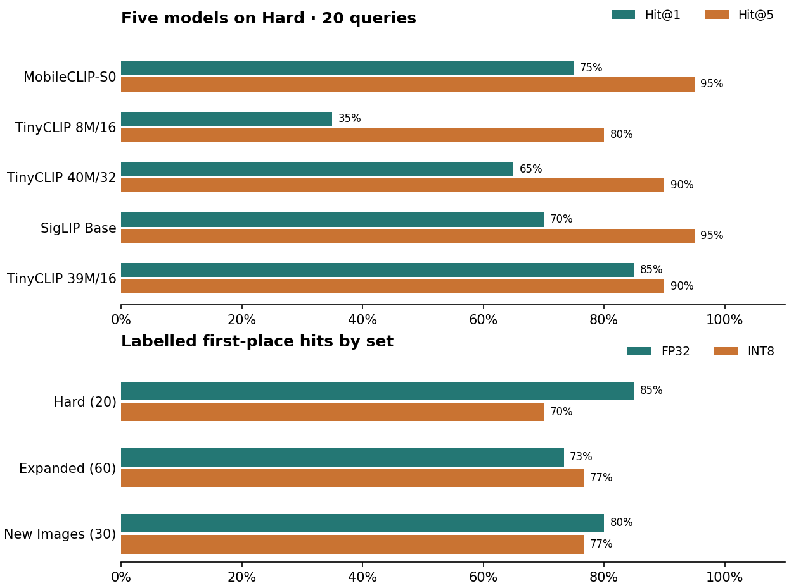

<p align="center"></p>

# TeachScribe · Finding the right photo on an Android tablet

**Alberto Reyes Castro · Applied AI Engineer, On-Device Multimodal ML**

<p align="center">
  <a href="report/TeachScribe_Public_Engineering_Case_Study_v5.pdf"></a>&nbsp;
  <a href="https://albertoreyescastro.github.io"></a>&nbsp;
  <a href="https://www.linkedin.com/in/albertoreyescastro/"></a>
</p>

<p align="center">
  <a href="docs/ARCHITECTURE.md">Architecture</a> ·
  <a href="docs/VALIDATION.md">Validation</a> ·
  <a href="evidence/data/README.md">Evidence</a> ·
  <a href="docs/README.md">Documentation</a> ·
  <a href="docs/PRIVACY.md">Privacy</a> ·
  <a href="NOTICE.md">Notice</a>
</p>

**I built and shipped TeachScribe's first on-device photo-search feature to all 50+ UK schools on its Early Years platform.** TeachScribe released the feature in its app on 19 November 2026. Feature-level usage metrics are pending.

Early Years teachers write observations while they work. Finding the photo that goes with a note can mean scrolling back through a camera roll. I built an Android feature that ranks local photos against the observation and shows five suggestions. The teacher can select several or record that none match. Observation text and photos stay on the tablet during retrieval. The feature uses no face recognition.

I compared five pretrained vision–language models, exported the selected encoders from PyTorch to ONNX, implemented the Android image path and embedding cache, and measured the result on a Huawei MediaPad M3 Lite 8. **108 cached searches over 44 photos took 441 ms at the median and 459 ms at P95.** I delivered the standalone ARM64 app to TeachScribe on 29 September 2026 at the end of my full-time engineering work (June–September).

[Engineering report (PDF)](report/TeachScribe_Public_Engineering_Case_Study_v5.pdf) · [Results and uncertainty](docs/RETRIEVAL_QUALITY.md)

## Current part-time work · September 2026–present

Alongside my MSc, I am developing the next version. I compared FP32 and INT8 retrieval on desktop, tested a candidate tokenizer against CLIP reference IDs and added checks for invalid embeddings. I wrote on-disk SQLite tests for a photo deleted during an active search and for recovery after interrupted writes. The requirement is to remove the deleted photo’s records while preserving the teacher’s notes and other photos.

Connecting that cleanup to a confirmed deletion in the app, validating the new build on the physical tablet and completing final release tests are still ahead. The September tablet timings describe the original benchmark.

## Technical deep dive

https://github.com/user-attachments/assets/686275ae-5e92-4469-83d3-fb213f77ac7a

**98-second narrated walkthrough** — on-device multimodal retrieval, model selection, INT8 deployment, Android optimisation, measured performance and validation.

## What it took to fit the device

| Engineering question | Measurement | Decision |
| --- | --- | --- |
| Which model should rank first? | On the 20-query Hard set, TinyCLIP 39M/16 placed a labelled image first 17 times. MobileCLIP-S0 did so 15 times, but placed a hit in the first five on 19 queries to TinyCLIP’s 18. | Select TinyCLIP on the strength of first-rank results, model licence and a workable ONNX export path. |
| What did quantisation cost? | The text encoder fell from 178,520,196 to 45,042,123 bytes (−74.77%). On Hard, the INT8 encoders lost three FP32 first-place hits. On Expanded, they gained two net. | Use separate INT8 encoders and report retrieval quality alongside the size saving. |
| Should the image model stay warm? | Preloading increased idle process PSS from 76.3 to 166.6 MiB. A search with every photo cached needs no image inference. | Load the image session on demand and reuse valid embeddings across searches and restarts. |
| How often should ranking yield to the UI? | On 37 candidates, changing the yield cadence reduced pipeline time from 530.92 to 379.42 ms. A less frequent yield reached 303.55 ms, with responsiveness concerns. | Keep the 20-candidate cadence. The lowest measured latency did not give the preferred interaction. |

## From a note to a reviewed observation


A local date or time window can narrow the candidate pool before ranking. I ported CLIP’s byte-level byte-pair encoding (BPE) tokenizer to TypeScript. It produces a 77-token input for the text encoder. Kotlin handles bounded image decoding and prepares 224 × 224 RGB inputs. Separate ONNX sessions produce 512-component vectors. The app ranks by cosine similarity. RAM coalesces repeated work and SQLite preserves valid image embeddings across restarts. A new or changed photo can incur decoding and image inference again.

The teacher’s choice and the original search results have independent records. Reopening a search preserves the suggestions originally shown. This also makes it possible to inspect a mismatch between the model’s ranking and a teacher’s later decision. The feature does not identify children or infer learning outcomes. [Architecture and timing boundaries](docs/ARCHITECTURE.md)

## How well did retrieval work?

Hit@k counts queries with a labelled relevant image among the first k results. The FP32 model-selection study ran on desktop CPU. Hard and Expanded used 16 candidates per query, New Images used 10. In the later desktop comparison, the exported INT8 text and image models used the same queries and images as their FP32 comparator.

| Set | Queries | Hit@1 · FP32 → INT8 | Hit@5 · FP32 → INT8 | Same first image |
| --- | ---: | ---: | ---: | ---: |
| Hard | 20 | 17 → 14 | 18 → 18 | 17/20 |
| Expanded | 60 | 44 → 46 | 55 → 54 | 52/60 |
| New Images | 30 | 24 → 23 | 30 → 30 | 28/30 |

Across the three related sets, the models ranked the same photo first **97/110** times. Either model could agree on an incorrect photo. The INT8 model recorded **83/110** labelled first-place hits and FP32 recorded **85/110**. On Hard, the Wilson 95% interval for INT8 Hit@1 spans 48.1–85.5%. The small, image-aware sets support inspecting individual trade-offs. They do not establish population accuracy or statistical equivalence.



[Five-model comparison, CPU times, paired losses and gains, confidence intervals](docs/RETRIEVAL_QUALITY.md) · [Underlying CSVs](evidence/data/README.md)

## What did the tablet measurements include?

The September benchmark used a **169.25 MiB ARM64 build on one Huawei MediaPad M3 Lite 8 (CPN-W09), Android 7**. The timer includes text encoding, cache access, scoring, sorting and scheduling. It stops before final rendering and history persistence. The median of the last 20 searches was 1.82% higher than the first 20.


| Condition | Observation | Interpretation |
| --- | --- | --- |
| 43 cached photos and one new photo | 4,225.41 ms total in one cold case | A new image can trigger session setup and preprocessing. The phase timings overlap. |
| Image preprocessing | Earlier reference ~2.20 s. Four later observations 0.37–0.50 s each. | Different photos were used. The measurements describe the change without a paired speedup estimate. |
| Battery-side measurement | 1.91 W idle and 2.71 W during search, about 0.49 mWh extra per search | An idle-subtracted, whole-device estimate for this workload. |
| SoC temperature | 33 °C idle, 34–37 °C during search, 34–39 °C in recovery. A longer run peaked at 41 °C. | These ranges belong to the measured phases on this device. |
| Stability | I observed no throttling during the controlled run. Stress-test logs showed no app crashes or application-not-responding (ANR) events. | These observations cover the benchmark device and the workloads tested. |
| APK packaging | 169.25 MiB benchmark, 143.84 MiB earlier clean package, 143.01 MiB handoff | The net package differences are 25.41 and 26.24 MiB. They do not isolate the compressed size of a duplicated resource. |

[All 108 timings](evidence/data/sustained_search_108_runs.csv) · [Five startup runs](evidence/data/startup_5_runs.csv) · [Power, memory and cold-path evidence](evidence/data/engineering_summary.json)

## What was verified, and when?

- **September · Android handoff.** Physical QA on the 143.01 MiB package covered retrieval, filtering and persisted history. The sustained benchmark above used an earlier package.
- **October · refactor.** I split the search screen into eight hooks, ten UI components and a 244-line entry screen. A TypeScript compiler API check found all 143 original code units preserved with zero mismatches during the module split. The 28 October suite passed 33 Node and 15 Python tests. On 27 October the tablet builds returned identical Top-5 order and scores on matched searches. The comparator did not check missing, extra or duplicate records. The original exports were unavailable for a stricter replay.
- **November · tokenizer candidate.** In a CPU comparison, the original and candidate tokenizers produced identical IDs on 110 historical queries. On a fixed gallery of eight public example photos, 7/50 deliberately difficult strings changed the first-ranked image. The candidate changes behaviour. These tests establish neither universal CLIP compatibility nor a new Android validation. [Protocol, control groups and results](docs/VALIDATION.md)

To recompute the published latency, model-size and retrieval statistics, run the following command from the repository root. The verifier uses standard-library Python.

```bash
python evidence/verify_stats.py
```

The public evidence includes the measurements, statistical summaries and this verification script. Product source, model exports, classroom media and linked records stay private. With TeachScribe's permission, Alberto Reyes Castro may share the private engineering repository with hiring teams he selects, for review only. Sharing grants no licence to use, copy, modify or distribute the code. [Evidence limits](docs/LIMITATIONS.md) · [Publication boundary](docs/PUBLICATION_BOUNDARY.md)

School feedback and feature-level usage data will help prioritise evaluation on larger galleries and more Android devices. A larger labelled evaluation set would let us test whether domain adaptation improves retrieval over the existing baseline.

TeachScribe describes its participation in the Department for Education’s AI Tools for Education programme and attributes programme funding to Innovate UK. This is background on the company. The feature measurements above come from my engineering evaluation. [Company statement](https://teachscribe.com/ofsted-early-years-inspections/)

I designed, built, measured and delivered the retrieval feature. After delivery, I used ChatGPT and Claude to help refactor code, review changes, develop tests and write technical documentation. I made the engineering decisions, reviewed the work and take responsibility for the accuracy of the published results. The walkthrough uses ElevenLabs narration with my own voice. TeachScribe Ltd owns the application code. [Disclosure](docs/AI_ASSISTANCE.md) · [Rights](LICENSE) · [Third-party notices](THIRD_PARTY_NOTICES.md)

[TeachScribe](https://www.teachscribe.com/) · [Portfolio](https://albertoreyescastro.github.io) · [LinkedIn](https://www.linkedin.com/in/albertoreyescastro/)
