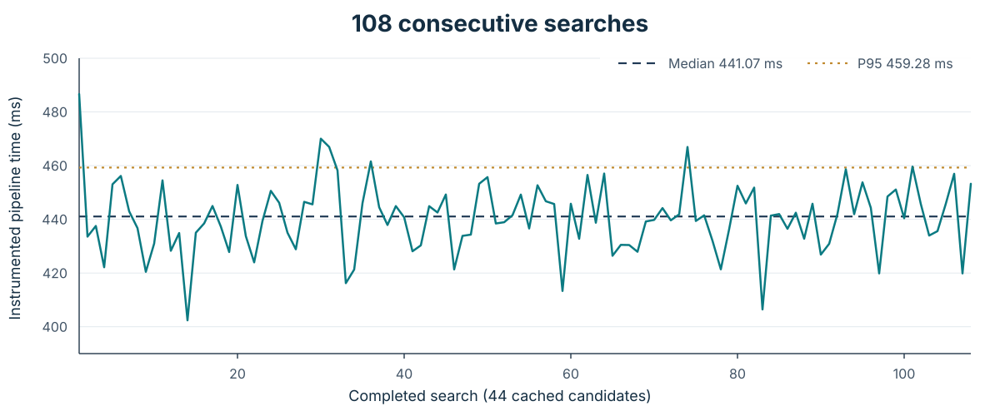

<p align="center"></p>

# TeachScribe — On-Device Multimodal Photo Retrieval

**Applied AI engineering case study · Alberto Reyes Castro**

Early Years teachers need to find the right classroom photos for a written observation, with the final choice remaining theirs.
I built the on-device retrieval pipeline: model evaluation, INT8 ONNX deployment, Kotlin preprocessing and persistent image-embedding reuse.
In a historical benchmark on one Android 7 tablet, 108 cached searches achieved **441.07 ms median / 459.28 ms P95**; these are instrumented pipeline timings, not full UI response times.

<p align="center">
  <a href="https://albertoreyescastro.github.io/assets/reports/TeachScribe_On_Device_Multimodal_Retrieval_Public_Engineering_Case_Study_v2.pdf"></a>&nbsp;
  <a href="https://albertoreyescastro.github.io"></a>&nbsp;
  <a href="https://www.linkedin.com/in/albertoreyescastro"></a>
</p>

<p align="center">
  <a href="docs/ARCHITECTURE.md">Architecture</a> ·
  <a href="docs/VALIDATION.md">Validation</a> ·
  <a href="evidence/data/README.md">Evidence</a>
</p>

## Results and scope

| Result | What was measured |
| :-- | :-- |
| **441.07 ms median / 459.28 ms P95** | 108 consecutive cached searches over 44 photos on one Huawei CPN-W09, Android 7 / ARM64 |
| **74.77% smaller text encoder** | 178,520,196 → 45,042,123 bytes after INT8 quantisation |
| **Hard Hit@1: FP32 17/20; INT8 14/20** | Desktop evaluation: 85% vs 70%; 95% Wilson intervals 64.0–94.8% and 48.1–85.5% |
| **Hit@1: FP32 85/110; INT8 83/110** | Descriptive sum across three related sets; not 110 independent trials |
| **Hit@5: FP32 103/110; INT8 102/110** | Same desktop comparison; 97/110 queries returned the same top-1 image |
| **76.3 MiB idle PSS** | Lazy image session; the 166.6 MiB preload variant was rejected |
| **≈0.5 mWh/search** | Whole-device, idle-subtracted estimate during the sustained run |

**Quality scope:** 17/20 is the FP32 model-selection result. The INT8 encoders scored 14/20 on the same Hard set in a later desktop comparison, using the application tokenizer and standard CLIP preprocessing. That comparison does not test the Android Kotlin preprocessing path. Per-set counts, intervals, losses/gains and exact McNemar values are in [Retrieval quality](docs/RETRIEVAL_QUALITY.md). A non-significant test does not establish equivalence.

**Performance scope:** these device measurements predate the portfolio refactor. Cached timing excludes final rendering and record persistence. The first/last-20 median change was **1.82%**, a descriptive comparison within this run, not proof of no drift or a guarantee for other workloads.



## What I built

- Evaluated **five pretrained vision-language models** and selected TinyCLIP 39M/16 based on retrieval trade-offs, licensing and its deployment path.
- Deployed INT8 text/image ONNX encoders with native Android preprocessing and persistent RAM + SQLite embedding reuse.
- Measured scheduling, preprocessing, memory, startup, thermal and battery-side behaviour; retained lazy image-model loading after measuring preload memory.
- Kept **human review** explicit: automatic Top-5 suggestions and search history are separate from the teacher's selected-photo/no-match decision.

The feature uses observation text and an optional local date/window filter to rank photos on the tablet. The retrieval path uses no remote inference service.

## Integration and validation

The feature was integrated into TeachScribe. The previously reported **50+ UK-school** figure describes the product's reach; it does not establish adoption of this retrieval feature. The quantitative results here come from controlled engineering evaluation, not production telemetry.

The recorded post-delivery validation included **33 Node tests**, **15 Python tests**, a **143-unit / 0-mismatch** mechanical refactor check and an on-device A/B comparison. These are historical checks with distinct scopes; they are not a new Android acceptance run of the current HEAD. [Validation](docs/VALIDATION.md) separates the delivered snapshot, later refactor, subsequent invalid-embedding guards and public numerical checks.

## Engineering decisions

| Decision | Evidence / trade-off |
| :-- | :-- |
| **TinyCLIP 39M/16 over MobileCLIP-S0** | higher Hit@1 on all three compared sets; paired differences did not establish broad statistical separation, so licensing and deployment path also mattered |
| **INT8 deployment** | text encoder bytes fell 74.77%; Hard Hit@1 fell from 17/20 to 14/20, while Expanded rose from 44/60 to 46/60. Per-set McNemar p ≥ 0.25 does not prove equivalence |
| **Persistent image cache** | fully cached searches can avoid image-model inference and pay only for text encoding, cache access, scoring/sorting and scheduling |
| **Fix decoding before inference** | later preprocessing observations were ~0.37–0.50 s versus an earlier ~2.2 s reference; different images, so not presented as a paired speedup |
| **Yield every 20 candidates** | 531 → 379 ms in the measured 37-candidate scheduling experiment; the faster ~304 ms policy was rejected after responsiveness concerns |
| **Keep image inference lazy** | proactive preloading increased idle PSS from 76.3 to 166.6 MiB |
| **Separate ranking from decisions** | successful-search history preserves the original Top-5; the teacher's later selected-photo/no-match decision is stored independently |

## Architecture


The architecture uses separate text and image encoders, native Android preprocessing, persistent image-vector reuse, cosine ranking and explicit human review. The public architecture retains tensor contracts, cache lifecycle, persistence behaviour, timing boundaries and trade-offs while omitting source-file maps and implementation bodies. See [Architecture](docs/ARCHITECTURE.md).

## Evidence you can verify

The repository publishes the underlying aggregate/de-identified data rather than only screenshots or headline claims: model selection, Wilson intervals, exact McNemar comparisons, INT8-vs-FP32 retrieval, all 108 sustained timings, warm/startup references, temporal cases and scoped engineering measurements.

Run the independent public verifier with standard-library Python:

```bash
python evidence/verify_stats.py
python -m unittest discover -s evidence -p 'test_*.py' -v
```

It recomputes every sustained-summary field and cross-checks retrieval counts, rates, Wilson intervals, exact McNemar values, schemas and run IDs. The mutation suite requires deliberately corrupted evidence to fail. This script is portfolio verification tooling, **not TeachScribe application source code**.

See [Evidence data](evidence/data/README.md), [Validation](docs/VALIDATION.md), [Limitations](docs/LIMITATIONS.md), [Privacy](docs/PRIVACY.md) and the [Publication boundary](docs/PUBLICATION_BOUNDARY.md).

## Evidence limits

The 20/60/30-query sets are small and partly related; queries were curated with knowledge of the images, and overlap with model pretraining is unknown. They are not an independent held-out population or a classroom-user trial. One older Android tablet does not establish modern-device coverage or large-gallery scalability. Desktop FP32/INT8 quality and Android cached-search timing are different experiments. Cosine similarity is not a probability, and this retrieval path does not identify people or infer learning outcomes. See [all limitations](docs/LIMITATIONS.md).

## Public / private boundary

This case study keeps the real architecture, aggregate measurements, model-selection evidence, de-identified acceptance cases and validation outcomes. It intentionally omits reusable product implementation: React Native/TypeScript application source, Kotlin native-module source, implementation tests/build scripts, model binaries, APKs, classroom imagery, real media identifiers and internal delivery correspondence.

Source-level hiring review requires **prior written approval from TeachScribe** for the specific recipients and material. A request does not itself grant access or permission to copy or redistribute code. The [review process](docs/PUBLICATION_BOUNDARY.md#hiring-review) describes that boundary.

## Technical deep dive

https://github.com/user-attachments/assets/686275ae-5e92-4469-83d3-fb213f77ac7a

**98-second narrated walkthrough** of the engineering work. The existing video predates these wording clarifications: the school count describes product reach, not measured feature adoption; thermal readings are specific to each run (a separate longer run reached 41 °C). Its narration and cards remain pending a complete revision.

*Narration was generated in ElevenLabs using my own voice clone. AI tools also assisted with post-delivery portfolio work; technical claims remain grounded in the engineering evidence.*

## Rights and AI assistance

TeachScribe Ltd owns the proprietary application code described by this case study. This repository is not an open-source release; see [LICENSE](LICENSE), [Rights and attribution notice](NOTICE.md) and [Third-party notices](THIRD_PARTY_NOTICES.md).

I designed, built, measured and delivered the retrieval prototype. Post-delivery portfolio refactoring, testing/documentation and publication work used AI pair-programming/editing assistance; the public evidence and private engineering repository provide the audit trail for the technical claims.

---

**Alberto Reyes Castro · Applied AI Engineer · London, UK**  
[Portfolio](https://albertoreyescastro.github.io) · [GitHub](https://github.com/albertoreyescastro) · [LinkedIn](https://www.linkedin.com/in/albertoreyescastro)
